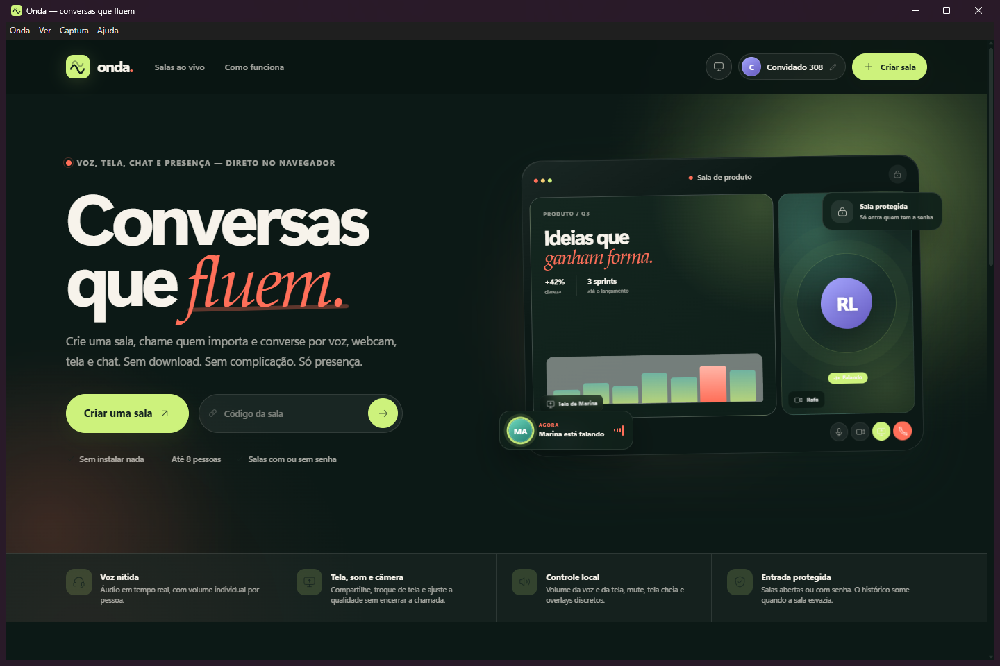
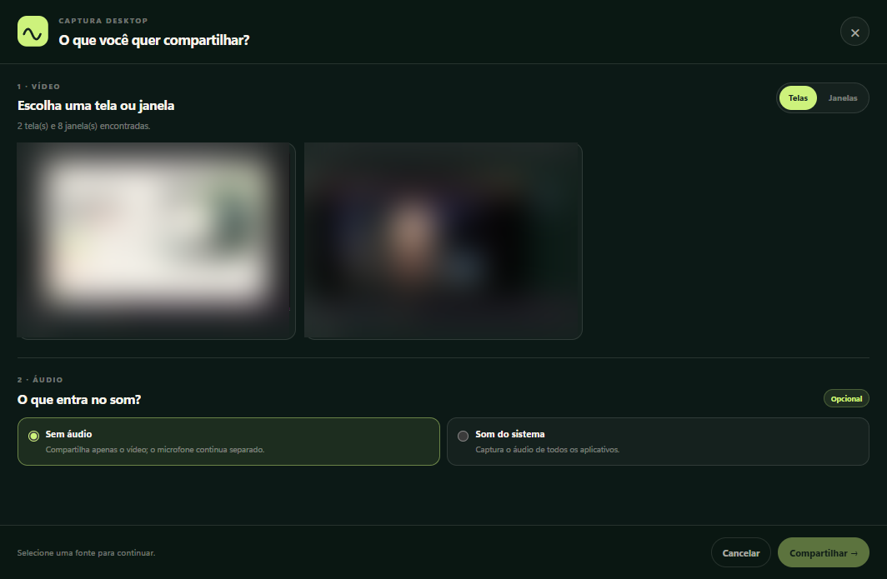

# Onda Desktop

> [Code signing policy](CODE_SIGNING.md)

Primeiro marco do aplicativo desktop do Onda. O objetivo é reaproveitar o site
Blazor online e adicionar captura nativa de áudio por aplicativo no Windows.

## Download e demonstração

- **Instalador Windows:** [última release](https://github.com/raiancollyn/ondaDesktop/releases/latest)
- **Site do Onda:** https://onda.dpbr.net
- **Política de assinatura:** [CODE_SIGNING.md](CODE_SIGNING.md)

As releases atuais ainda não são assinadas; o Windows SmartScreen pode avisar.

## Capturas

| Aplicativo no Windows | Seletor de captura |
| --- | --- |
|  |  |

No seletor, as miniaturas das telas foram desfocadas para preservar a privacidade
do ambiente usado na captura.

## Estado atual

Implementado:

- shell Electron que carrega `https://onda.dpbr.net` (ou `ONDA_URL`);
- deep link `onda://sala/<codigo>`;
- seletor de telas/janelas com thumbnails;
- seletor de áudio por aplicativo, com sessões de áudio ativas;
- bridge no `site.js` que substitui `getDisplayMedia` quando
  `window.ondaDesktop` existe;
- seletor aberto dentro do `setDisplayMediaRequestHandler` do Electron;
- sidecar C# `OndaCapture` com:
  - `--list` para processos e sessões de áudio;
  - `--capture` para capturar PCM float32 de um processo (incluindo ou excluindo
    sua árvore de processos);
- áudio nativo encaminhado por IPC, convertido em faixa WebAudio e anexado ao
  `MediaStream` de tela;
- **captura nativa de vídeo GDI** em um sidecar C# (960×540, alvo de 60 fps,
  JPEG por IPC), usada quando o WGC/DXGI falha;
- fallback final por thumbnails GDI via `desktopCapturer`;
- seletor contextual de áudio:
  - tela inteira: sem áudio ou som do sistema, com exclusão opcional de um
    aplicativo;
  - janela: sem áudio ou som do processo dono da janela;
- lista inicial de processos em primeiro plano/abertos, com **Carregar mais
  processos**;
- seletor abre imediatamente com estado de carregamento, enquanto as fontes e
  miniaturas (320×180) são carregadas em segundo plano.

Ainda não implementado:

- assinatura de código;
- múltiplas exclusões de áudio simultâneas;
- macOS e Linux;
- validação completa da transmissão em uma sala/LiveKit real.

O menu **Captura → Testar seletor de captura** continua disponível para validar
fontes e processos sem iniciar uma chamada.

> A bridge fica no `site.js`. Para testá-la no desktop, o site precisa estar
> atualizado — use `npm run start:local` com a instância local do Blazor ou
> publique a alteração em `onda.dpbr.net`.

## Requisitos

- Windows x64;
- Node.js 22.12+;
- .NET SDK 10;
- site online acessível (ou uma instância local em `ONDA_URL`).

## Rodar

> **Não abra `OndaCapture.exe` para iniciar o aplicativo.** Ele é apenas o
> componente nativo de captura de áudio. Sem argumentos, ele mostra uma
> mensagem explicativa e permanece aberto. O aplicativo é o Electron.

No Explorer, dê dois cliques em:

```text
desktop/iniciar-onda.cmd
```

Ou, no terminal:

```powershell
cd desktop
npm install
npm run native:build
npm start
```

O script `iniciar-onda.cmd` limpa `ELECTRON_RUN_AS_NODE`, instala as
dependências se necessário, compila o sidecar, inicia o Electron com
`--no-sandbox` e mantém o console aberto se o Electron sair com erro.

### Por que `--no-sandbox`?

Em alguns Windows o sandbox do Chromium não consegue criar o processo de GPU.
O sintoma é:

```text
GPU process launch failed: error_code=18
FATAL:... GPU process isn't usable. Goodbye.
```

O código 18 é `SBOX_ERROR_CREATE_PROCESS`. Para fazer o app abrir nesses
ambientes, o launcher inicia com `--no-sandbox`. Isso reduz o isolamento do
Chromium, por isso o app carrega apenas o domínio confiável do Onda e abre links
externos no navegador. Para tentar o sandbox normal:

```powershell
$env:ONDA_ALLOW_SANDBOX = "1"
npm start
```

Se o app abrir normalmente sem a variável, o problema era o sandbox; se voltar
a falhar com o erro 18, mantenha o padrão.

### Pasta de dados local

Para evitar caches presos ou redirecionados no `%APPDATA%`, o app usa:

- desenvolvimento: `desktop/.userdata`;
- pacote instalado: `%LOCALAPPDATA%\OndaDesktop`.

Se uma execução antiga deixou cache preso, execute `limpar-cache.cmd` e abra
novamente.

### Sandbox, pasta de instalação e WGC

O WGC do Chromium só funciona corretamente quando o Electron inicia com o
sandbox normal. Em pastas de usuário/workspace, o GPU pode falhar com
`SBOX_ERROR_CREATE_PROCESS` (código 18).

Comportamento atual do launcher:

- rodando de `Documents`/workspace: usa `--no-sandbox`;
- rodando de `%LOCALAPPDATA%\Programs\...` ou `Program Files`: inicia com o
  sandbox normal e, consequentemente, usa o caminho WGC do Chromium;
- `ONDA_ALLOW_SANDBOX=1` força o sandbox;
- `ONDA_ALLOW_SANDBOX=0` ou `ONDA_NO_SANDBOX=1` força `--no-sandbox`.

Foi validado que, instalado em `%LOCALAPPDATA%\Programs`, o compartilhamento
de janela usa o WGC e **não** inicia o `OndaCapture --video`; o sidecar fica
apenas no áudio (`--capture`).

Para apontar para o site local:

```powershell
npm run start:local
```

O script `start:local` assume `http://127.0.0.1:5062`. Em outro endereço:

```powershell
$env:ONDA_URL = "http://127.0.0.1:5062"
npm start
```

## Sidecar

O sidecar fica em `native/OndaCapture` e usa
[ApplicationLoopback.NET](https://github.com/Yellow-Dog-Man/ApplicationLoopback.NET)
para a captura por árvore de processos no Windows.

Listar processos e sessões de áudio:

```powershell
dotnet build native/OndaCapture/OndaCapture.csproj -c Release
.\native\OndaCapture\bin\Release\net10.0\win-x64\OndaCapture.exe --list
```

Capturar um processo para um arquivo cru de teste:

```powershell
.\native\OndaCapture\bin\Release\net10.0\win-x64\OndaCapture.exe `
  --capture --pid 1234 --mode include --duration 2 --output capture.raw
```

O áudio é PCM float32 little-endian, 48 kHz, 2 canais intercalados. O cabeçalho
JSON é escrito no stdout antes do PCM.

Publicar o sidecar self-contained:

```powershell
npm run native:publish
```

Saída em `desktop/dist/native/`. O aplicativo procura o executável em
`resources/native/`, `dist/native/` e no diretório de build de desenvolvimento.
Também é possível definir `ONDA_CAPTURE_EXE`.

## Empacotamento

O instalador Windows é gerado com:

```powershell
npm run dist
```

Isso publica o sidecar self-contained e cria:

```text
release/Onda-Setup-0.1.0.exe
```

O instalador NSIS é **one-click**, por usuário, sem administrador. Ele instala
em `%LOCALAPPDATA%\Programs\Onda`, cria atalhos na área de trabalho e no menu
Iniciar, registra o protocolo `onda://` e abre o aplicativo.

O build do NSIS precisa rodar em um caminho normal do Windows. Neste projeto ele
foi validado copiando o workspace para `C:\OndaBuild` e executando o build em um
terminal aberto pelo Explorer. Rodando de `Documents`/workspace do DSH, a etapa
de geração do desinstalador pode falhar com código 2.

Também existe o pacote ZIP como alternativa:

```powershell
npm run dist:zip
```

Ele gera `release/Onda-Setup-0.1.0.zip` com `instalar.cmd` e `install.ps1`; o
resultado é equivalente ao instalador, mas sem entrada em Aplicativos
instalados/desinstalador automático.

## Auto-update

O app usa `electron-updater` com releases do GitHub.

- verifica atualizações 5 segundos depois de abrir e a cada 6 horas;
- baixa a atualização em segundo plano;
- pergunta se deve reiniciar;
- se o usuário escolher “Depois”, aplica ao fechar o app.

O provedor está configurado em `package.json`:

```json
"publish": [
  {
    "provider": "github",
    "owner": "raiancollyn",
    "repo": "ondaDesktop",
    "releaseType": "release"
  }
]
```

O auto-update só funciona em builds empacotados/instalados, não em `npm start`.

## Release no GitHub

O workflow `.github/workflows/release.yml` roda ao enviar uma tag `v*`.

Fluxo:

```powershell
npm version patch --no-git-tag-version
git add package.json package-lock.json
git commit -m "Release v0.1.1"
git tag v0.1.1
git push
git push origin v0.1.1
```

O workflow:

1. valida a tag contra a versão do `package.json`;
2. instala Node e .NET;
3. publica o sidecar self-contained;
4. gera o NSIS;
5. publica o instalador, `latest.yml` e blockmap no GitHub Release.

O `latest.yml` é obrigatório para o auto-update. Não publique a release sem ele.

O app ainda não está assinado. Assine o `Onda.exe`, o `OndaCapture.exe` e o
instalador antes de divulgar o auto-update para evitar piorar o SmartScreen.
Também é necessário configurar `publisherName`/assinatura para a validação de
atualização quando o certificado for adicionado.

Ainda falta:

- assinatura de código (SmartScreen e validação de update);
- validar a atualização em uma instalação real;
- instalador ARM64.

## Estrutura

```text
desktop/
  electron/
    main.cjs            # janela, deep link, menu, IPC e seletor
    preload.cjs         # bridge segura para o site
    picker-preload.cjs  # bridge do seletor
  picker/
    index.html
    picker.css
    picker.js
  native/OndaCapture/
    Program.cs
    OndaCapture.csproj
```

O site recebeu a integração em `Onda/wwwroot/js/site.js` e
`Onda/Components/App.razor` continua carregando esse arquivo. O Electron expõe
`window.ondaDesktop` pelo preload, abre o seletor no
`setDisplayMediaRequestHandler`, inicia o sidecar e encaminha o PCM ao renderer.

## Limitações conhecidas

- O `ApplicationLoopback` aceita uma árvore de processos por captura. O MVP
  oferece uma inclusão ou uma exclusão; várias exclusões exigirão mixagem.
- A lista de processos do Windows pode retornar títulos vazios em alguns
  contextos. As sessões de áudio ativas são cruzadas com os processos para
  destacar os aplicativos que estão produzindo som.
- O shell foi validado no ambiente de desenvolvimento com `--no-sandbox` e uma
  pasta `.userdata` local: site carregado e WebSocket do Blazor conectado.
- O fluxo de captura foi validado neste ambiente: o WGC/DXGI falhou, o
  capturador nativo GDI entrou automaticamente e a chamada de `getDisplayMedia`
  retornou faixas de **vídeo e áudio** vivas. O seletor contextual e o novo
  carregamento também foram exercitados. Falta validar a publicação em uma sala
  mesh/LiveKit e a qualidade visual em um desktop normal.
- A captura GDI é limitada pela cópia de tela + JPEG + decode no renderer. Em
  960×540 o renderer mediu ~43 fps; em 720p ficou em ~39 fps. Para 60 fps reais
  é necessário usar WGC/DXGI ou uma pipeline de vídeo com encoder/decoder de
  hardware.
- O capturador GDI de janela usa `PrintWindow` e, quando o quadro vem preto,
  copia a região visível da tela. Uma janela totalmente encoberta pode aparecer
  coberta; para melhor resultado, mantenha a janela visível durante o
  compartilhamento.
- O `--no-sandbox` é um contorno de compatibilidade. O ideal futuro é detectar
  a elevação/ACL do Windows e iniciar sem administrador, mantendo o sandbox.
- O sidecar é win-x64. ARM64 exigirá um build próprio da biblioteca nativa.

## Modo de compatibilidade da tela

Em alguns Windows o Windows Graphics Capture (WGC) e o DXGI são bloqueados por
política, driver ou sessão remota. Nesses casos o Chromium retorna
`NotReadableError` e a captura normal não abre.

O Onda tenta, nesta ordem:

1. `getDisplayMedia` normal;
2. captura desktop legada via `getUserMedia`;
3. capturador nativo GDI no sidecar (960×540, alvo de 60 fps, JPEG por IPC);
4. quadros GDI capturados pelo `desktopCapturer`.

O capturador nativo evita enumerar todas as janelas a cada quadro, que é o que
deixava a versão anterior em 1–4 fps. O áudio do aplicativo continua sendo
capturado nativamente, sem perda de qualidade. É um modo de compatibilidade:
funciona onde o WGC falha, mas tem menos fluidez que a captura normal.

Na medição local, o sidecar entregou ~55 fps e o renderer exibiu ~43 fps em
960×540. O teto de 60 fps depende de WGC/DXGI + pipeline de hardware; o GDI com
JPEG no renderer ainda não sustenta 60 fps em 720p.

### Áudio contextual

- **Tela inteira:** sem áudio ou som do sistema. Com som do sistema, é possível
  marcar **Desativar o som de um aplicativo** e escolher um processo.
- **Janela:** sem áudio ou som do processo dono da janela.

A lista inicial prioriza processos com áudio ativo, em primeiro plano ou com
janela aberta. **Carregar mais processos** libera a lista completa.

> Em navegadores, o áudio é capturado por processo, não por aba. Uma janela do
> navegador pode incluir o som de outras janelas do mesmo processo.

## Se a janela abrir e fechar

1. Execute `iniciar-onda.cmd` pelo terminal, não pelo sidecar.
2. Se aparecer `GPU process launch failed: error_code=18`, use o launcher
   atualizado: ele passa `--no-sandbox`.
3. Se aparecer erro de cache/arquivo em uso, execute `limpar-cache.cmd` e abra
   novamente.
4. Confirme que o site `https://onda.dpbr.net` está acessível e atualizado com
   a bridge do `site.js`.
5. Para testar sem depender do site de produção, suba uma instância local e use
   `npm run start:local`.

## Próximo marco

1. Validar em uma sala real com WGC, áudio por aplicativo e 60 fps.
2. Validar atualização/auto-update; instalação, atalhos, protocolo e desinstalação já foram testados.
3. Assinar o executável/instalador.
4. Depois, múltiplas exclusões e macOS/Linux.

## Licença

MIT. Veja [`LICENSE`](LICENSE).

O copyright está como `Raian Collyn`. Se o titular legal for uma empresa, troque
o nome no arquivo `LICENSE` antes de distribuir.

